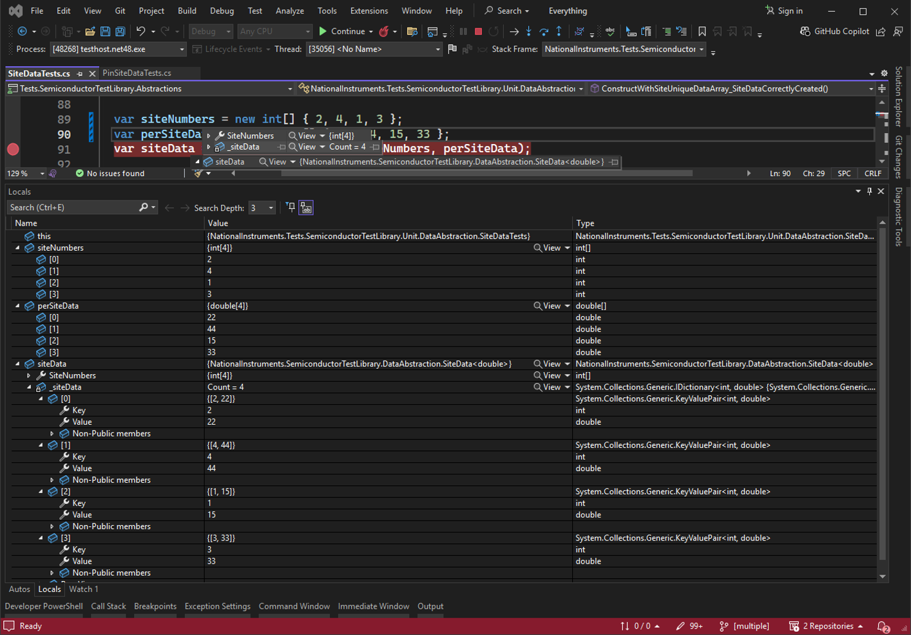
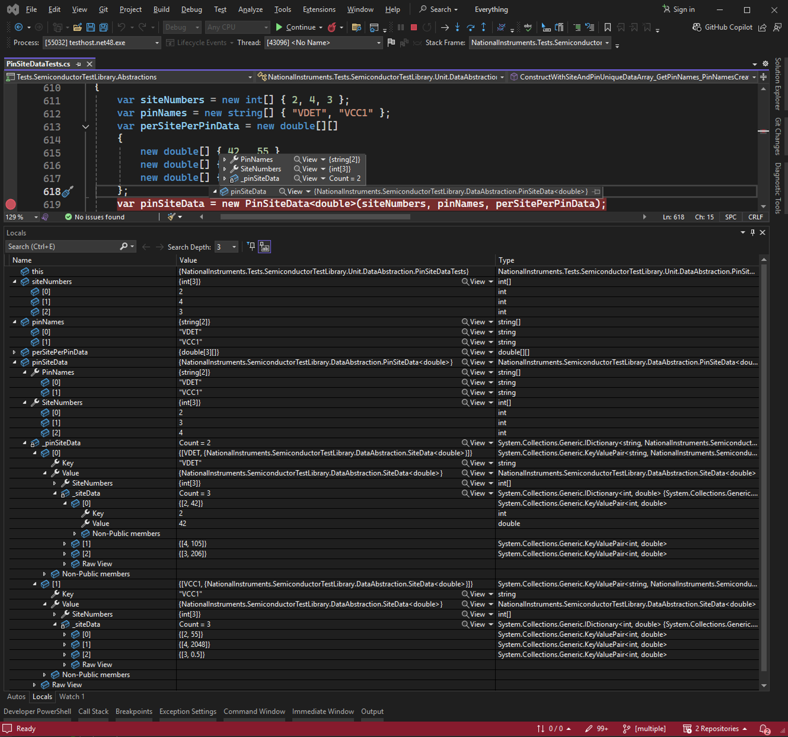

# Data Abstraction

The Semiconductor Test Library provides Pin- and Site-Aware data types to simplify how you configure instrumentation and manage returned measurement results. The high-level extension methods both return and accept these types as input parameters. This abstracts your need to manage confusing array manipulations or translate between instrument- and channel-formatted data to pin- and site-formatted data. Basic math functions can also be operated on these types.

## Pin- and Site-Aware Data Types

---

### SiteData

Class: `SiteData<T>` \
Namespace: `NationalInstruments.SemiconductorTestLibrary.DataAbstraction`

Defines an object containing values for one or more sites, where `T` can be passed as any data type.

This type is returned from methods in the Semiconductor Test Library where there may be a unique per-site value. This type can also be passed as an input parameter to some Semiconductor Test Library methods when there is a unique per-site value to operate with.

The `SiteData` object exposes basic methods for extracting a single site value or subset of values. In release 26.5.0 or later, you can also add and remove sites and set values after the object is created. For more information, refer to [Working with SiteData](DataAbstraction/SiteData.md). Additionally, frequently used [mathematical operations](MathOperations/MathOperationsWithSiteData.md) can be performed on a `SiteData` object for the most commonly used data types.

>[!NOTE]
> Refer to the API Reference for more details regarding the properties and methods exposed by the `SiteData`.
>
> Find examples for using the `SiteData` object [here on GitHub](https://github.com/ni/semi-test-library-dotnet/tree/main/Examples/source/CodeSnippets/DataAbstraction).

A `SiteData` object is a dictionary of key-value pairs, where each key corresponds to a unique site number, and each value represents site-specific data for that site. This is also the observable structure when debugging a `SiteData` object at runtime in Visual Studio, as shown in the example below.

**Example of `SiteData` objects in Visual Studio at runtime**



---

### PinSiteData

Class: `PinSiteData<T>` \
Namespace: `NationalInstruments.SemiconductorTestLibrary.DataAbstraction`

Defines an object containing values for one or more sites that are associated with a particular pin or set of pins, where `T` can be passed as any data type.

This type is returned from methods in the Semiconductor Test Library, such as measurement methods, where there may be a unique value for each pin, regardless of whether the value is the same across all sites and/or pins. This type can also be passed as an input parameter to some Semiconductor Test Library methods when there is a unique per-site, per-pin value to operate with.

The `PinSiteData` object exposes basic methods for extracting a single site value or subset of values. In release 26.5.0 or later, you can also add and remove pins and sites and set values after the object is created. For more information, refer to [Working with PinSiteData](DataAbstraction/PinSiteData.md). Additionally, frequently used [mathematical operations](MathOperations/MathOperationsWithPinSiteData.md) can be performed on a `PinSiteData` object for the most commonly used data types.

>[!NOTE]
> Refer to the API Reference for more details regarding the properties and methods exposed by the `PinSiteData`.
>
> Find examples for using the `PinSiteData` object [here on GitHub](https://github.com/ni/semi-test-library-dotnet/tree/main/Examples/source/CodeSnippets/DataAbstraction).

A `PinSiteData` object is a dictionary of key-value pairs, where each key corresponds to a unique pin name, and each value is a `SiteData` object containing site-unique data for the given pin. This is also the observable structure when debugging a `SiteData` object at runtime in Visual Studio, as shown in the example below.

**Example of `PinSiteData` objects in Visual Studio at runtime:**



---

## Publishing SiteData/PinSiteData Results

The Semiconductor Test Library provides extension methods for the TSM `ISemiconductorModuleContext` object to publish `SiteData` and `PinSiteData` objects as test results. These methods publish one result for each active site, and for `PinSiteData` objects, one result for each pin. For more information about how published results are evaluated, refer to [Publishing Results](PublishingResults.md).

Class: `Publish` \
Namespace: `NationalInstruments.SemiconductorTestLibrary.Common`

The following table outlines the methods available for publishing results.

**Table of Methods for Publishing Results:**

|Method|Description|
| :- | :- |
|[`PublishResults<T>(PinSiteData<T> results, string publishedDataId)`](../SemiconductorTestLibrary/NationalInstruments.SemiconductorTestLibrary.Common.Publish.PublishResults.html)|Publishes the value of each pin for each active site. Each result is associated with its pin.|
|[`PublishResults<T>(SiteData<T> results, string publishedDataId, string pin = "")`](../SemiconductorTestLibrary/NationalInstruments.SemiconductorTestLibrary.Common.Publish.PublishResults.html)|Publishes the value of each active site. The results are associated with the specified pin, if one is provided.|
|[`PublishResult<T>(T result, string publishedDataId, string pin = "")`](../SemiconductorTestLibrary/NationalInstruments.SemiconductorTestLibrary.Common.Publish.PublishResult.html)|Publishes the same value for all active sites.|
|[`PublishSingleSiteResult<T>(T result, string publishedDataId, string pin = "")`](../SemiconductorTestLibrary/NationalInstruments.SemiconductorTestLibrary.Common.Publish.PublishSingleSiteResult.html)|Publishes a value for a single site. Use this method only with a single-site `ISemiconductorModuleContext` object.|

### Usage Considerations for Publishing Results

When publishing `SiteData` and `PinSiteData` objects you should consider the following:

1. The `publishedDataId` input must match a published data ID that is defined for the test step in TestStand.
2. Results are published only for the active sites of the `ISemiconductorModuleContext` object. Values for sites that are not active are ignored.
3. Each active site must have a value. If the object does not contain a value for an active site, the value of the site-agnostic site `-1` is published for that site instead. If neither exists, an `NISemiconductorTestException` is thrown with the message `Measurement data for site {siteNumber} is missing.`
4. The `PublishResults<T>(PinSiteData<T> results, string publishedDataId)` method publishes each pin separately. Therefore, each pin must have a value for every active site, or a value for site `-1`. This applies to jagged `PinSiteData` objects as well.
5. The `PublishResults<T>(PinSiteData<T> results, string publishedDataId)` method associates each result with its pin name. If the pin name is a pin group, the results are associated with the first pin in the pin group.
6. If a `PinSiteData` object contains no pins, nothing is published and no exception is thrown.
7. The `PublishResults<T>(SiteData<T> results, string publishedDataId, string pin = "")` method does not associate the results with a pin by default. Specify the `pin` input when the results must be associated with a specific pin.
8. Only the following data types are supported for publishing: `double`, `int`, `uint`, `long`, `bool`, and `string`. Any other data type, including arrays, causes an `NISemiconductorTestException` to be thrown with the message `Cannot publish measurement data. The {type} data type is invalid.` Use the [`Select`](#data-transforms-using-select-method) method to convert the data to a supported type before publishing.
9. Results are published one site at a time. If an exception is thrown for a site, the results already published for the preceding sites and pins remain published.
10. Many instrument abstraction methods also provide variants that measure and publish in a single call, such as `MeasureAndPublishCurrent` and `BurstPatternAndPublishResults`.

### Example Usage for Publishing Results

Example of publishing per-pin, per-site results and per-site results:

```csharp
TSMSessionManager sessionManager = new TSMSessionManager(tsmContext);
DCPowerSessionsBundle vdd = sessionManager.DCPower("VDD");
DigitalSessionsBundle sdo = sessionManager.Digital("SDO");

// Publishes one result for each pin and each active site.
PinSiteData<double> currentMeasurements = vdd.MeasureCurrent();
tsmContext.PublishResults(currentMeasurements, publishedDataId: "VDD_Current");

// Publishes one result for each active site.
SiteData<bool> passFail = sdo.GetSitePassFail();
tsmContext.PublishResults(passFail, publishedDataId: "SDO_PassFail");
```

Example of publishing the results of a single pin, associated with that pin:

```csharp
PinSiteData<double> currentMeasurements = vdd.MeasureCurrent();
SiteData<double> vddCurrent = currentMeasurements.ExtractPin("VDD");
tsmContext.PublishResults(vddCurrent, publishedDataId: "VDD_Current", pin: "VDD");
```

Example of converting the data to a supported type before publishing:

```csharp
// Arrays cannot be published directly.
// Select the maximum value of the multi-point measurement for each pin and site, and then publish it.
PinSiteData<double[]> multiPointMeasurement = dmmPins.ReadMultiPoint(sampleCount, maximumTimeInMilliseconds: 5000);
PinSiteData<double> maxValue = multiPointMeasurement.Select(samples => samples.Max());
tsmContext.PublishResults(maxValue, publishedDataId: "MaxMultiPointValue");
```

>[!NOTE]
> The `SetValue` method used in the following example is available only in release 26.5.0 or later.

Example of publishing a site-agnostic value for all active sites:

```csharp
// SystemSupply is a system pin, so its value is stored for the site-agnostic site -1.
var pinSiteData = new PinSiteData<double>();
pinSiteData.SetValue(value: -22.5, pinName: "SystemSupply", siteNumbers: -1);

// The value of site -1 is published for each active site, associated with the SystemSupply pin.
tsmContext.PublishResults(pinSiteData, publishedDataId: "SystemSupplyVoltage");
```

---

## Extracting a Site Subset from SiteData/PinSiteData

You can get the data for a single site or a subset of sites from a `SiteData` or `PinSiteData` object. The methods that return a subset of sites create a new object, and the original object is not modified.

The following table outlines the methods and properties available for extracting site data.

**Table of Methods and Properties for Extracting Site Data:**

|Type|Member|Description|
| :- | :- | :- |
|`SiteData<T>`|[`SiteNumbers`](../SemiconductorTestLibrary/NationalInstruments.SemiconductorTestLibrary.DataAbstraction.SiteData-1.SiteNumbers.html)|Returns the site numbers in the `SiteData` object, in ascending order.|
|`SiteData<T>`|[`GetValue(int siteNumber)`](../SemiconductorTestLibrary/NationalInstruments.SemiconductorTestLibrary.DataAbstraction.SiteData-1.GetValue.html)|Returns the value of the specified site.|
|`SiteData<T>`|[`TryGetValue(int siteNumber, out T value)`](../SemiconductorTestLibrary/NationalInstruments.SemiconductorTestLibrary.DataAbstraction.SiteData-1.TryGetValue.html)|Gets the value of the specified site, if it exists. Returns `true` if the site exists, and `false` otherwise.|
|`SiteData<T>`|[`ExtractSites(int[] siteNumbers)`](../SemiconductorTestLibrary/NationalInstruments.SemiconductorTestLibrary.DataAbstraction.SiteData-1.ExtractSites.html)|Returns a new `SiteData` object that contains only the specified sites.|
|`PinSiteData<T>`|[`SiteNumbers`](../SemiconductorTestLibrary/NationalInstruments.SemiconductorTestLibrary.DataAbstraction.PinSiteData-1.SiteNumbers.html)|Returns the union of the site numbers across all pins, in ascending order.|
|`PinSiteData<T>`|[`ExtractSite(int siteNumber)`](../SemiconductorTestLibrary/NationalInstruments.SemiconductorTestLibrary.DataAbstraction.PinSiteData-1.ExtractSite.html)|Returns a dictionary that contains the value of each pin for the specified site, where each key is a pin name.|
|`PinSiteData<T>`|[`ExtractSites(int[] siteNumbers)`](../SemiconductorTestLibrary/NationalInstruments.SemiconductorTestLibrary.DataAbstraction.PinSiteData-1.ExtractSites.html)|Returns a new `PinSiteData` object that contains all pins, but only the specified sites.|

### Usage Considerations for Extracting a Site Subset

When extracting site data from `SiteData` and `PinSiteData` objects you should consider the following:

1. The `ExtractSites` methods return a new object. Modifying the returned object does not modify the original object, and vice versa. However, when `T` is a reference type, such as an array, both objects refer to the same value instances.
2. Every specified site must exist. Otherwise, an `NISemiconductorTestException` is thrown with the message `The site number {siteNumber} does not exist.` Use the `TryGetValue` method or check the `SiteNumbers` property first if a site might not exist.
3. The `GetValue` and `ExtractSites` methods of `SiteData` throw an `NISemiconductorTestException` if the `SiteData` object is empty.
4. The `ExtractSite` and `ExtractSites` methods of `PinSiteData` throw an `NISemiconductorTestException` if the `PinSiteData` object contains no pins or no sites.
5. The `ExtractSite` and `ExtractSites` methods of `PinSiteData` require every pin to contain each of the specified sites. For a jagged `PinSiteData` object, or an object that contains system pins with only the site-agnostic site `-1`, first use the `ExtractPins` method to select the pins that contain the sites. For more information, refer to [Extracting a Pin Subset from PinSiteData](#extracting-a-pin-subset-from-pinsitedata).
6. The `siteNumbers` input must contain unique values. If the `siteNumbers` input is an empty array, the returned object contains no sites.
7. The `SiteNumbers` property returns a new array each time it is accessed. Store the array in a local variable instead of accessing the property repeatedly.

### Example Usage for Extracting a Site Subset

Example of extracting site data from a `SiteData` object:

```csharp
var siteData = new SiteData<double>(new int[] { 0, 1, 2, 3 }, new double[] { 1.1, 2.2, 3.3, 4.4 });
// Site  |  0    |  1    |  2    |  3
// Value |  1.1  |  2.2  |  3.3  |  4.4

// Gets the value of site 2.
double site2Value = siteData.GetValue(2);
// 3.3

// Gets the value of site 5, if it exists.
bool site5Exists = siteData.TryGetValue(5, out double site5Value);
// site5Exists = false, site5Value = 0.0

// Creates a new SiteData object that contains only sites 1 and 3.
SiteData<double> subset = siteData.ExtractSites(new int[] { 1, 3 });
// Site  |  1    |  3
// Value |  2.2  |  4.4
```

Example of extracting site data from a `PinSiteData` object:

```csharp
// Pin    | Site 0 | Site 1 | Site 2
// VDET   |  1.5   |  1.6   |  1.7
// VCC1   |  3.3   |  3.4   |  3.5

// Gets the value of each pin for site 1.
IDictionary<string, double> site1Values = pinSiteData.ExtractSite(1);
// { ["VDET"] = 1.6, ["VCC1"] = 3.4 }

// Creates a new PinSiteData object that contains all pins, but only sites 0 and 2.
PinSiteData<double> subset = pinSiteData.ExtractSites(new int[] { 0, 2 });
// Pin    | Site 0 | Site 2
// VDET   |  1.5   |  1.7
// VCC1   |  3.3   |  3.5
```

Example of filtering data that is stored for all sites down to the active sites of the current code module:

```csharp
// Retrieves the data exactly as it was stored, regardless of the active sites.
PinSiteData<double> allSitesData = tsmContext.GetGlobalPinSiteData<double>("ReferenceData", filterForActiveSites: false);

// Creates a new PinSiteData object that contains only the active sites.
int[] activeSites = tsmContext.SiteNumbers.ToArray();
PinSiteData<double> activeSitesData = allSitesData.ExtractSites(activeSites);
```

---

## Extracting a Pin Subset from PinSiteData

You can get the pin information, the data for a single pin, or the data for a subset of pins from a `PinSiteData` object. The methods that return pin data create a new object, and the original object is not modified.

The following table outlines the methods and properties available for extracting pin data.

**Table of Methods and Properties for Extracting Pin Data:**

|Member|Description|
| :- | :- |
|[`PinNames`](../SemiconductorTestLibrary/NationalInstruments.SemiconductorTestLibrary.DataAbstraction.PinSiteData-1.PinNames.html)|Returns the pin names in the `PinSiteData` object.|
|[`SiteNumbersByPin`](../SemiconductorTestLibrary/NationalInstruments.SemiconductorTestLibrary.DataAbstraction.PinSiteData-1.SiteNumbersByPin.html)|Returns a read-only dictionary where each key is a pin name and each value is the list of site numbers for that pin, in ascending order. This property is applicable only to release 26.5.0 or later.|
|[`GetValue(int siteNumber, string pinName)`](../SemiconductorTestLibrary/NationalInstruments.SemiconductorTestLibrary.DataAbstraction.PinSiteData-1.GetValue.html)|Returns the value of the specified pin and site.|
|[`TryGetValue(int siteNumber, string pinName, out T value)`](../SemiconductorTestLibrary/NationalInstruments.SemiconductorTestLibrary.DataAbstraction.PinSiteData-1.TryGetValue.html)|Gets the value of the specified pin and site, if it exists. Returns `true` if the pin and site exist, and `false` otherwise.|
|[`ExtractPin(string pinName)`](../SemiconductorTestLibrary/NationalInstruments.SemiconductorTestLibrary.DataAbstraction.PinSiteData-1.ExtractPin.html)|Returns a new `SiteData` object that contains the data of the specified pin.|
|[`ExtractPins(string[] pinNames)`](../SemiconductorTestLibrary/NationalInstruments.SemiconductorTestLibrary.DataAbstraction.PinSiteData-1.ExtractPins.html)|Returns a new `PinSiteData` object that contains only the specified pins.|

### Usage Considerations for Extracting a Pin Subset

When extracting pin data from `PinSiteData` objects you should consider the following:

1. The `ExtractPin` and `ExtractPins` methods return a new object. Modifying the returned object does not modify the original object, and vice versa. However, when `T` is a reference type, such as an array, both objects refer to the same value instances.
2. Every specified pin must exist. Otherwise, an `NISemiconductorTestException` is thrown with the message `The pin name {pinName} does not exist.` Use the `TryGetValue` method or check the `PinNames` property first if a pin might not exist.
3. The `GetValue`, `ExtractPin`, and `ExtractPins` methods throw an `NISemiconductorTestException` if the `PinSiteData` object contains no pins.
4. The `GetValue` method throws an `NISemiconductorTestException` if the specified pin contains no sites, or if the specified site does not exist for the pin.
5. The `TryGetValue` method returns `false` if the specified pin or site does not exist. However, it throws an `NISemiconductorTestException` if the specified pin exists but contains no sites.
6. The `ExtractPin` method returns an empty `SiteData` object if the specified pin contains no sites. For a jagged `PinSiteData` object, the returned `SiteData` object contains only the sites of that pin.
7. The `pinNames` input of the `ExtractPins` method must contain unique values. Otherwise, an `NISemiconductorTestException` is thrown. An `ArgumentException` is thrown if the `pinNames` input is an empty array.
8. The `PinNames` and `SiteNumbersByPin` properties return a new array or dictionary each time they are accessed. Store the returned value in a local variable instead of accessing the property repeatedly. The `SiteNumbersByPin` property is applicable only to release 26.5.0 or later.
9. The order of the `PinNames` property is not guaranteed to match the order in which the pins were added.

### Example Usage for Extracting a Pin Subset

Example of extracting pin data from a `PinSiteData` object:

```csharp
// Pin          | Site -1 | Site 0 | Site 1
// VDET         |  ---    |  1.5   |  1.6
// VCC1         |  ---    |  3.3   |  3.4
// SystemSupply | -22.5   |  ---   |  ---

// Gets the pin names and the sites of each pin.
string[] pinNames = pinSiteData.PinNames;
// { "VDET", "VCC1", "SystemSupply" }

IReadOnlyDictionary<string, IReadOnlyList<int>> siteNumbersByPin = pinSiteData.SiteNumbersByPin;
// { ["VDET"] = { 0, 1 }, ["VCC1"] = { 0, 1 }, ["SystemSupply"] = { -1 } }

// Gets the value of VCC1 for site 1.
double vcc1Site1Value = pinSiteData.GetValue(siteNumber: 1, pinName: "VCC1");
// 3.4

// Gets the value of VDET for site -1, if it exists.
bool valueExists = pinSiteData.TryGetValue(siteNumber: -1, pinName: "VDET", out double value);
// valueExists = false, value = 0.0

// Creates a new SiteData object that contains the data of VCC1.
SiteData<double> vcc1 = pinSiteData.ExtractPin("VCC1");
// Site  |  0    |  1
// Value |  3.3  |  3.4

// Creates a new PinSiteData object that contains only the DUT pins.
PinSiteData<double> dutPins = pinSiteData.ExtractPins(new string[] { "VDET", "VCC1" });
// Pin    | Site 0 | Site 1
// VDET   |  1.5   |  1.6
// VCC1   |  3.3   |  3.4

// Since the DUT pins all contain site 0, a site subset can now be extracted.
// Calling ExtractSites on the original object throws an exception, because SystemSupply does not contain site 0.
PinSiteData<double> site0Data = dutPins.ExtractSites(new int[] { 0 });
// Pin    | Site 0
// VDET   |  1.5
// VCC1   |  3.3
```

---

## Data Transforms Using Select Method

The `Select` method performs an operation on each value of a `SiteData` or `PinSiteData` object, and returns a new object that contains the results. The returned object contains the same sites, and for `PinSiteData` objects, the same pins as the original object. The operation can return a different data type, which makes the `Select` method useful for converting data from one type to another.

The following table outlines the `Select` methods.

**Table of Select Methods:**

|Method|Description|
| :- | :- |
|[`SiteData<T>.Select<TResult>(Func<T, TResult> operation)`](../SemiconductorTestLibrary/NationalInstruments.SemiconductorTestLibrary.DataAbstraction.SiteData-1.Select.html)|Performs the operation on the value of each site and returns a new `SiteData<TResult>` object.|
|[`PinSiteData<T>.Select<TResult>(Func<T, TResult> operation)`](../SemiconductorTestLibrary/NationalInstruments.SemiconductorTestLibrary.DataAbstraction.PinSiteData-1.Select.html)|Performs the operation on the value of each pin and site, and returns a new `PinSiteData<TResult>` object.|

### Usage Considerations for the Select Method

When using the `Select` method you should consider the following:

1. The `Select` method does not modify the original object.
2. The operation can be a lambda expression, a method, or a local function that accepts a value of type `T` and returns a value of type `TResult`. `TResult` can be any data type.
3. The underlying data type of the original object, `T`, must be one of the following types, or an array type:
    `double`, `decimal`, `float`, `int`, `uint`, `long`, `ulong`, `byte`, `sbyte`, `short`, `ushort`.
    Otherwise, an `NISemiconductorTestException` is thrown with the message `Math operations not supported on the {type} type data.` For example, the `Select` method cannot be called on a `SiteData<bool>` or `SiteData<string>` object. For these types, iterate over the sites and set the values in a new object instead. For more information, refer to [Working with SiteData in Loops](DataAbstraction/SiteData.md#working-with-sitedata-in-loops).
4. The `Select` method of `SiteData` throws an `NISemiconductorTestException` if the `SiteData` object is empty.
5. The `Select` method of `PinSiteData` throws an `NISemiconductorTestException` if the `PinSiteData` object contains no pins, or if any pin contains no sites. Jagged `PinSiteData` objects are supported, and the returned object has the same jagged structure.
6. If the operation throws an exception for any value, the `Select` method stops and throws an `NISemiconductorTestException`. The exception message includes the site, and for `PinSiteData` objects, the pin where the exception occurred, along with the original exception details.
7. For basic arithmetic, the [math operations](MathOperations/MathOperationsWithSiteData.md) such as `Add` and `Multiply` are more concise. Use the `Select` method for custom operations and type conversions.
8. The `Select` method was introduced in the 24.5.1 release.

### Example Usage for the Select Method

Example of converting the data type:

```csharp
var intData = new SiteData<int>(new int[] { 1, 2 });
// Casts each site value to a double.
SiteData<double> doubleData = intData.Select(value => (double)value);
// Site  |  0    |  1
// Value |  1.0  |  2.0
```

Example of reducing array data to a single value per pin and site:

```csharp
PinSiteData<double[]> multiPointMeasurement = dmmPins.ReadMultiPoint(sampleCount, maximumTimeInMilliseconds: 5000);
// Selects the maximum value of the samples for each pin and site.
PinSiteData<double> maxValue = multiPointMeasurement.Select(samples => samples.Max());
tsmContext.PublishResults(maxValue, publishedDataId: "MaxMultiPointValue");
```

Example of aggregating per-sample comparison results into a single pass/fail result per site:

```csharp
SiteData<bool[]> comparisonResults = measurement.Compare<uint[], bool[]>(ComparisonType.EqualTo, expectedData);
// Returns true for a site only if all the samples of that site match.
SiteData<bool> aggregateResult = comparisonResults.Select(result => result.All(value => value));
tsmContext.PublishResults(aggregateResult, publishedDataId: "ComparisonResult");
```

Example of using a local function to transform array data into a string:

```csharp
var captureData = new SiteData<uint[]>(new uint[][]
{
    new uint[] { 192, 3 }, // Site 0 data
    new uint[] { 32, 128 } // Site 1 data
});
SiteData<string> hexData = captureData.Select(SumSamplesAndRepresentAsHexString);
// Site  |  0    |  1
// Value | "C3"  | "A0"

string SumSamplesAndRepresentAsHexString(uint[] samples)
{
    var sum = samples.Sum(sample => sample);
    return $"{sum:X}";
}
```

Example of a `Select` operation :x: **NOT ALLOWED**:

```csharp
SiteData<bool> passFail = sdo.GetSitePassFail();

var passFailAsInt = passFail.Select(value => value ? 1 : 0);
// The above operation will throw an NISemiconductorTestException with the following message:
// "Math operations not supported on the System.Boolean type data."
```

>[!NOTE]
> The `SetValue` method used in the following example is available only in release 26.5.0 or later.

The same transform can be performed by iterating over the sites instead:

```csharp
SiteData<bool> passFail = sdo.GetSitePassFail();

var passFailAsInt = new SiteData<int>();
int[] siteNumbers = passFail.SiteNumbers;
foreach (int siteNumber in siteNumbers)
{
    passFailAsInt.SetValue(passFail.GetValue(siteNumber) ? 1 : 0, siteNumber);
}
```
