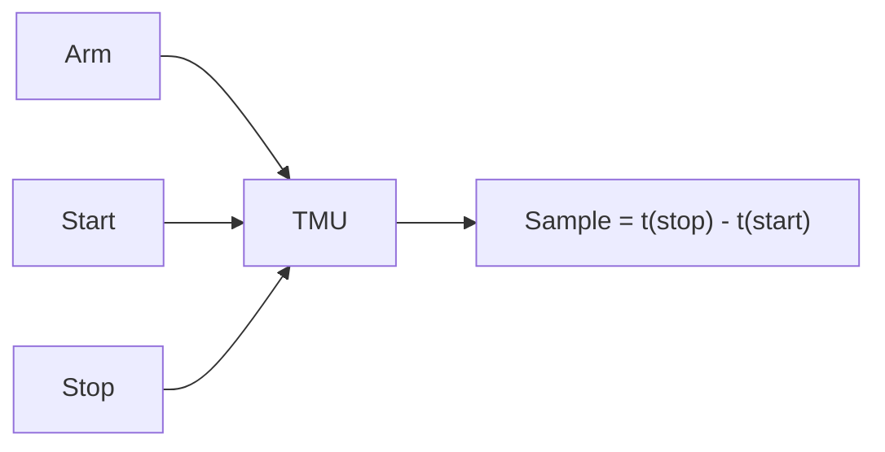

# Time Measurement Unit (TMU)

The Digital Instrument Abstraction allows you to use the Time Measurement Unit (TMU) of an NI Digital Pattern Instrument to make timing measurements on digital pins, such as period, pulse width, duty cycle, rise time, fall time, and skew.

The TMU measures the time between digital events. These events can occur on the same pin or on different pins. The Semiconductor Test Library handles the pin and site awareness for TMU operations. It assigns the limited TMU resources of each instrument to the target pins and sites. It returns the measurement results as `PinSiteData`.

> [!NOTE]
> Supported in Semiconductor Test Library 26.5 NuGet package or later.
>
> TMU measurements require STS Software 26.5.0 or later. The Semiconductor Test Library remains compatible with earlier versions of STS Software, but TMU measurements are not available with them.

## TMU Overview

Each TMU has three primary inputs: arm, start, and stop. After the arm condition is satisfied, the TMU records the time of the digital transitions at the start and stop inputs. It uses these times to produce a single sample, which is the time difference between the stop event and the start event.



The following terms are used throughout this document:

- **Timestamp**: The recorded time value of a detected digital event, such as a transition on a pin.
- **Sample**: A single data point that represents the time difference between two events. A sample is calculated from a pair of timestamps (start and stop).
- **Measurement**: A collection of one or more samples acquired during a TMU measurement.

Each start and stop input is defined by the following settings:

- **Source**: The pin that the event is detected on.
- **Source event**: The comparator threshold used to detect the event, either `Voh` or `Vol`.
- **Source event polarity**: The edge used to detect the event, either rising or falling.

Because the TMU detects edges using the `Voh` and `Vol` comparator thresholds, the pin levels must be configured to match the amplitude of the signal being measured.

For more details about TMU hardware concepts, refer to the NI-Digital Pattern Driver documentation.
<!-- TODO: Add the link to the NI-Digital Pattern Driver TMU documentation. -->

## TMU Resources

TMU resources are limited per instrument module. Each 32-channel PXIe-657x Digital Pattern Instrument has **2 TMUs**, which are shared by all channels of that module.

You need one TMU for each pin, on each site, that you want to measure at the same time. A TMU can only measure pins on the module that contains the TMU. The number of measurements that can run at the same time on a given module is limited by the number of TMUs on that module, not by the number of channels.

> [!NOTE]
> Not all digital pattern instruments support the TMU. Refer to the NI Digital Pattern Instruments (PXIe-657x) documentation for details.

You can use the `GetTMUCount` method to query the total number of TMU resources available. The method returns one value for each instrument session in the `DigitalSessionsBundle` object. Each value is the total across all modules in that session.

### Assigning, Reserving, and Releasing TMU Resources

The library manages TMU resources in two stages: assignment and reservation.

- **Assignment**: The `AssignTMUResources` method assigns an available TMU on the associated module to each target pin and site in the bundle. Assignment happens only in software. It does not reserve the TMU in hardware. The library records each assignment in two places:
  - The bundle object records which TMU is assigned to each of its pins and sites. All other TMU methods use this record to find the TMU to operate on.
  - A list shared by the whole process records which TMUs are in use. It does not record which bundle object, pin, or site a TMU is assigned to. `AssignTMUResources` uses this list so that a TMU in use cannot be assigned to another bundle object until it is released.
- **Reservation**: The assigned TMU is reserved in hardware when it is enabled. All the measurement configuration methods, such as `ConfigurePeriodMeasurement`, enable the assigned TMU, so you don't need to call `EnableTMU` separately. The `DisableTMU` method disables the assigned TMU and unreserves it in hardware. The TMU configuration remains unchanged.
- **Release**: The `ClearTMUAssignment` method clears the assignment and returns the TMU to the resource pool. You must disable the TMU before you clear the assignment. If any assigned TMU is still enabled, this method throws an exception.

The following list shows the lifecycle of a TMU resource:

1. `AssignTMUResources`: Assigns a TMU in software.
2. `Configure...Measurement` or `EnableTMU`: Enables the TMU and reserves it in hardware.
3. `TMUInitiate`, then `FetchAveragedTMUMeasurement`: Performs the measurement.
4. `DisableTMU`: Unreserves the TMU in hardware.
5. `ClearTMUAssignment`: Releases the TMU to the resource pool.

Keep the following caveats in mind when working with TMU resources:

- **Always release the resources.** Call `DisableTMU` and then `ClearTMUAssignment` at the end of every code module that assigns TMU resources. Only `ClearTMUAssignment`, or the automatic cleanup after a failure, returns a TMU to the resource pool. Closing the instrument sessions does not release TMU assignments.
  - If you skip `DisableTMU`, the TMU remains enabled and reserved in hardware. `ClearTMUAssignment` throws an exception for an enabled TMU, so the assignment cannot be cleared.
  - If you skip `ClearTMUAssignment`, the TMU remains assigned for the lifetime of the process, even though it is disabled.

  In either case, that TMU cannot be assigned to any other bundle object, for any pin or site. Later calls to `AssignTMUResources` on a new bundle object throw an exception when the module has no other free TMUs. Calling `AssignTMUResources` again on the same bundle object does not fail, because it reuses the TMUs already assigned to that bundle object.
- **Use the same bundle object.** The record of which TMU is assigned to each pin and site is stored in the `DigitalSessionsBundle` object that `AssignTMUResources` was called on, not in the pin or the instrument session. Use that same bundle object for all subsequent TMU operations. A new bundle object queried from `TSMSessionManager` has no assigned TMUs, even for the same pin and site. Calling `AssignTMUResources` on it assigns a different, additional TMU from the same module. If no other TMU is free on that module, the method throws an exception. Methods that operate on the assigned TMU, such as the configure, enable, initiate, fetch, and `GetTMU...` setting query methods (but not `GetTMUCount`), throw an exception when called on a bundle object that has no assigned TMUs.
- **Filtered bundles copy the current assignment.** `FilterBySite` and `FilterByPin` copy the bundle object's record of assigned TMUs at the time the filter is applied. If you filter a bundle object after assigning TMU resources, both bundle objects refer to the same TMUs. Clearing the assignment on one of them returns the TMUs to the pool, but the other bundle object still refers to them and can operate on them after they are assigned elsewhere. Filter the bundle object first, and then assign, use, and release the TMU resources on the filtered bundle object.
- **Failure cleanup.** If any TMU extension method throws an exception, the library aborts, disables, and releases the TMUs assigned to every pin in the bundle, not only the targeted pins. This prevents TMU resources from being stranded. If you want to retry, you must call `AssignTMUResources` again.
- **Insufficient resources.** If there are not enough TMUs available on a module for all the targeted pins and sites, `AssignTMUResources` throws an exception and rolls back any partial assignment.

### Scaling with Sites

Each site-pin pair needs its own TMU. As a result, the number of sites you can measure at the same time is limited by the number of TMUs on the module that the pins are mapped to.

For example, assume a pin is mapped to the same 32-channel PXIe-657x module across 4 sites. The module has only 2 TMUs, so only 2 of the 4 sites can be measured at the same time. If you call `AssignTMUResources` for all 4 sites at once, the method throws an exception.

Use one or more of the following approaches to work within this limit:

- **Measure in batches.** Use the `FilterBySite` or `FilterByPin` methods of the `DigitalSessionsBundle` object to create a bundle that needs no more TMUs than are available. Filter before you assign TMU resources. Then complete the full assign, configure, initiate, fetch, disable, and clear sequence on the filtered bundle before you move to the next batch. Alternatively, target a subset of pins by passing the `pinNames` parameter to the TMU methods.
- **Distribute pins across modules.** TMUs are allocated per module. When you design the pin map, mapping the measured pins for different sites to different modules increases the number of measurements that can run at the same time.
- **Account for concurrent execution.** All code that runs in the same process draws from the same pool of TMU resources. If code modules for different sites run at the same time on separate threads, they compete for the same TMUs. Release resources as soon as the measurement is complete. In addition, `FetchAveragedTMUMeasurement` locks the NI-Digital session until the measurement completes or times out. During that time, TMU operations for other sites that use the same session must wait.

> [!TIP]
> For a skew measurement, only the reference pin needs a TMU. The target pin is used as the stop source of the reference pin's TMU, so you don't need to assign a TMU to it.

## Arming

The arm input of the TMU frames, or selects, the start and stop events of interest for each sample. The measurement configuration methods expose this through the `armSetting` parameter, which accepts a `TmuArmSetting` value:

- `TmuArmSetting.Immediate` (default): Arms each sample immediately. The TMU begins looking for start and stop events as soon as the measurement is initiated.
- `TmuArmSetting.StartEdge`: Arms each sample on an edge that has the same source, event, and polarity as the start source.
- `TmuArmSetting.StopEdge`: Arms each sample on an edge that has the same source, event, and polarity as the stop source.

TMU samples are signed time intervals, so the measurement result can be negative. With `TmuArmSetting.Immediate`, if the signal is free-running, the TMU might detect the stop event before the start event. If you need a positive time interval, use `TmuArmSetting.StartEdge` to set the order of the events.

> [!NOTE]
> If you configure arming using the lower-level methods (`ConfigureTMUArmType`, `ConfigureTMUEdgeArmSource`, `ConfigureTMUEdgeArmSourceEvent`, and `ConfigureTMUEdgeArmPolarity`), the edge arm source, event, and polarity must match those of the corresponding start source or stop source. Otherwise, the driver returns an error when the measurement is initiated.

## Taking a TMU Measurement

The following steps show how to take a TMU measurement:

1. Query the `DigitalSessionsBundle` object for the target pins.
2. Assign TMU resources using the `AssignTMUResources` method.
3. Configure the measurement using one of the measurement configuration methods. This also enables and reserves the assigned TMU.
4. Initiate the measurement using the `TMUInitiate` method. This method returns immediately. It doesn't wait for the measurement to complete.
5. Fetch the averaged result using the `FetchAveragedTMUMeasurement` method. This method waits for the measurement to complete, up to the specified timeout, and returns a `PinSiteData<double>` that contains the averaged time, in seconds, for each pin and site.
6. Disable the TMU using the `DisableTMU` method, and release the assignment using the `ClearTMUAssignment` method.

> [!NOTE]
> Before initiating, `TMUInitiate` sets the selected function of the target pins to `Digital` and the termination mode to `HighZ`. The driver validates and commits the TMU configuration when `TMUInitiate` is called. Once a measurement is initiated, the TMU configuration cannot be modified until the measurement completes or is aborted using the `TMUAbort` method.

### Example Usage

The following C#/.NET code snippet shows how to measure the period of a signal on the `C0` pin.

```C#
var sessionManager = new TSMSessionManager(tsmContext);
var digitalPins = sessionManager.Digital("C0");

// Assign a TMU resource to each pin and site in the bundle.
digitalPins.AssignTMUResources();

// Configure and enable (reserve) the assigned TMU resources.
digitalPins.ConfigurePeriodMeasurement(
    edgeType: TmuPolarity.RisingEdge,
    samplesToAcquire: 100,
    armSetting: TmuArmSetting.StartEdge);

// Initiate the measurement and fetch the averaged result.
digitalPins.TMUInitiate();
PinSiteData<double> period = digitalPins.FetchAveragedTMUMeasurement(timeoutInSeconds: 5.0);
tsmContext.PublishResults(period, publishedDataId: "Period");

// Disable the TMU resources and release them back to the resource pool.
digitalPins.DisableTMU();
digitalPins.ClearTMUAssignment();
```

The following C#/.NET code snippet shows how to measure the skew between a reference pin, `C0`, and a target pin, `C1`. The bundle must contain both pins, but only the reference pin needs a TMU.

```C#
string[] referencePins = new[] { "C0" };
string[] targetPins = new[] { "C1" };

var sessionManager = new TSMSessionManager(tsmContext);
var digitalPins = sessionManager.Digital(new[] { "C0", "C1" });

digitalPins.AssignTMUResources(pinNames: referencePins);
digitalPins.ConfigureTMUSkewMeasurement(
    referencePinNames: referencePins,
    targetPinNames: targetPins,
    edgeType: TmuPolarity.RisingEdge,
    samplesToAcquire: 100,
    armSetting: TmuArmSetting.StartEdge);

digitalPins.TMUInitiate(pinNames: referencePins);
PinSiteData<double> skew = digitalPins.FetchAveragedTMUMeasurement(timeoutInSeconds: 5.0, pinNames: referencePins);
tsmContext.PublishResults(skew, publishedDataId: "Skew");

digitalPins.DisableTMU(pinNames: referencePins);
digitalPins.ClearTMUAssignment(pinNames: referencePins);
```

Code snippets for each measurement type are available in the [CodeSnippets/InstrumentAbstraction](https://github.com/ni/semi-test-library-dotnet/tree/main/Examples/source/CodeSnippets/InstrumentAbstraction) directory of the repository.

There is also a sequence style example available that showcases a complete working example of each TMU measurement type.
Refer to the [TMU Example README](https://github.com/ni/semi-test-library-dotnet/blob/main/Examples/source/Sequence/TMU/README.md) for more details.

## API Overview

The TMU methods are extension methods of the `DigitalSessionsBundle` class. Most methods accept an optional `pinNames` parameter, or have an overload that accepts a single `pinName`, so that you can target a subset of the pins in the bundle. If you don't specify any pins, all pins in the bundle are targeted.

> [!NOTE]
> Class: `TmuExtensions` \
> Namespace: `NationalInstruments.SemiconductorTestLibrary.InstrumentAbstraction.Digital` \
> Assembly: `NationalInstruments.SemiconductorTestLibrary.Extensions.dll`
>
> The TMU enumeration types, such as `TmuPolarity` and `TmuArmSetting`, are defined in the `NationalInstruments.SemiconductorTestLibrary.InstrumentAbstraction.Digital.TMU` namespace.
>
> Refer to the API Reference for more details regarding the `TmuExtensions` class.

### Resource Management

| Method | Description |
| --- | --- |
| `AssignTMUResources` | Assigns an available TMU to each target pin and site in software. |
| `EnableTMU` | Enables and reserves the assigned TMU in hardware. |
| `DisableTMU` | Disables and unreserves the assigned TMU in hardware. The TMU configuration remains unchanged. |
| `ClearTMUAssignment` | Clears the assignment and releases the TMU back to the resource pool. |
| `GetTMUCount` | Returns the total number of TMU resources for each instrument session in the bundle. |

### Measurement Configuration

These methods configure the start and stop sources, the number of samples, and the arm setting. They also enable the assigned TMU.

| Method | Start Event | Stop Event |
| --- | --- | --- |
| `ConfigurePeriodMeasurement` (`RisingEdge`) | Rising edge at `Voh` | Rising edge at `Voh`, on the same pin |
| `ConfigurePeriodMeasurement` (`FallingEdge`) | Falling edge at `Vol` | Falling edge at `Vol`, on the same pin |
| `ConfigureTMUPulseWidthMeasurement` (`High`) | Rising edge at `Voh` | Falling edge at `Vol`, on the same pin |
| `ConfigureTMUPulseWidthMeasurement` (`Low`) | Falling edge at `Vol` | Rising edge at `Voh`, on the same pin |
| `ConfigureTMUDutyCycleMeasurement` (`High`) | Rising edge at `Voh` | Falling edge at `Voh`, on the same pin |
| `ConfigureTMUDutyCycleMeasurement` (`Low`) | Falling edge at `Vol` | Rising edge at `Vol`, on the same pin |
| `ConfigureTMURiseTimeMeasurement` | Rising edge at `Vol` | Rising edge at `Voh`, on the same pin |
| `ConfigureTMUFallTimeMeasurement` | Falling edge at `Voh` | Falling edge at `Vol`, on the same pin |
| `ConfigureTMUSkewMeasurement` | Selected edge on the reference pin (rising edge at `Voh` or falling edge at `Vol`) | Same edge on the target pin |

> [!NOTE]
> The duty cycle measurement returns the time, in seconds, that the signal spends in the high or low state, not a percentage. To express the result as a ratio, divide it by the period of the signal.

For skew measurements, a positive result means the target edge occurs after the reference edge, and a negative result means it occurs before.

### Measurement Execution

| Method | Description |
| --- | --- |
| `TMUInitiate` | Validates the configuration and starts the measurement. Returns immediately. |
| `FetchAveragedTMUMeasurement` | Waits for the measurement to complete and returns the averaged result, in seconds, as `PinSiteData<double>`. |
| `TMUAbort` | Aborts any in-progress measurement. Does not affect the configuration or reservation state. |

### Individual Setting Configuration and Queries

For use cases that the measurement configuration methods don't cover, you can configure each TMU setting individually, and then enable the TMU using `EnableTMU`. These methods include `ConfigureTMUStartSource`, `ConfigureTMUStopSource`, `ConfigureTMUStartSourceEvent`, `ConfigureTMUStopSourceEvent`, `ConfigureTMUStartSourceEventPolarity`, `ConfigureTMUStopSourceEventPolarity`, `ConfigureTMUArmType`, `ConfigureTMUEdgeArmSource`, `ConfigureTMUEdgeArmSourceEvent`, `ConfigureTMUEdgeArmPolarity`, `ConfigureTMUSamplesToAcquire`, and `ConfigureTMUSampleTimeout`.

Each setting has a corresponding `GetTMU...` method that returns the current value of the setting for each pin and site as `PinSiteData`. For example, `GetTMUStartSource`, `GetTMUEnabled`, and `GetTMUSampleTimeout`.

## Low-Level TMU Programming

If you need TMU capabilities that the `TmuExtensions` methods don't expose, you can program the TMU directly using the TMU .NET APIs of the NI-Digital Pattern Driver. You can call these APIs on the underlying NI-Digital session by using the `Do` methods of the `ParallelExecution` class, in the same way as other low-level driver calls. For more information, refer to [Making Low-Level Driver Calls](advanced/MakingLowLevelDriverCalls.md).

> [!NOTE]
> Low-level TMU programming requires STS Software 26.5.0 or later, which includes the TMU .NET APIs of the NI-Digital Pattern Driver.
>
> Namespace: `NationalInstruments.ModularInstruments.NIDigital`
>
> Refer to the [NI-Digital Pattern Driver C#.NET API Reference](https://www.ni.com/docs/en-US/bundle/ni-digital-pattern-csharp-api-ref/page/api-reference.html) for more details regarding the TMU classes.

The NI-Digital Pattern Driver provides the following TMU classes:

| Class | Description |
| --- | --- |
| `DigitalTmuCollection` | Provides access to the TMUs of an NI-Digital session through the `NIDigital.Tmu` property. Use the `GetTmu` method to get the `DigitalTmu` object for a TMU context, such as `"PXI1Slot2/tmu0"`. |
| `DigitalTmu` | Configures and operates a single TMU. Provides the `Enabled`, `SamplesToAcquire`, `SampleTimeout`, and `ArmType` properties, the `Start`, `Stop`, and `EdgeArm` configuration objects, and the `Initiate`, `Abort`, and `FetchAveragedMeasurement` methods. |
| `DigitalTmuSource` | Configures the start or stop source of a TMU: `Source`, `SourceEvent`, `SourceEventPolarity`, and `InputDebounceTime`. |
| `DigitalTmuEdgeArm` | Configures the edge arm source of a TMU: `Source`, `SourceEvent`, and `Polarity`. |

### Translating Extension Method Types

Some types that you pass to the `TmuExtensions` methods are specific to the Semiconductor Test Library. They have no equivalent in the driver, so you must translate them into the individual TMU settings when you program the TMU at a lower level.

| Extension Method Type | Driver Settings |
| --- | --- |
| `TmuArmSetting.Immediate` | `ArmType` = `TmuArmType.Immediate` |
| `TmuArmSetting.StartEdge` | `ArmType` = `TmuArmType.Edge`. The `EdgeArm` source, event, and polarity match those of the start source. |
| `TmuArmSetting.StopEdge` | `ArmType` = `TmuArmType.Edge`. The `EdgeArm` source, event, and polarity match those of the stop source. |
| `TmuPulseWidth`, `TmuDutyCycle` | The start and stop sources, events, and polarities listed in the [Measurement Configuration](#measurement-configuration) table. |

The `TmuSourceEvent`, `TmuPolarity`, and `TmuArmType` enumerations of the Semiconductor Test Library use the same names and values as the corresponding driver enumerations. If you need to pass a value returned by a `GetTMU...` extension method to the driver, cast it to the driver enumeration type.

### Resolving Type Name Conflicts

The `NationalInstruments.SemiconductorTestLibrary.InstrumentAbstraction.Digital.TMU` namespace contains types with the same names as the driver TMU types, such as `DigitalTmu`, `TmuPolarity`, and `TmuSourceEvent`. If your code file includes using directives for both this namespace and the `NationalInstruments.ModularInstruments.NIDigital` namespace, the compiler reports an ambiguous reference error.

> [!NOTE]
> The `DigitalTmuCollection`, `DigitalTmu`, `DigitalTmuSource`, and `DigitalTmuEdgeArm` classes in the Semiconductor Test Library namespace are used internally by the `TmuExtensions` methods. They are not intended for use in your code, and they will be removed in a future release. Use the driver TMU classes instead.

To avoid the conflict, use one of the following approaches:

- If your code file only uses the driver TMU types, don't include a using directive for the `NationalInstruments.SemiconductorTestLibrary.InstrumentAbstraction.Digital.TMU` namespace.
- If your code file also passes TMU enumerations to the `TmuExtensions` methods, use an alias for the Semiconductor Test Library namespace, and qualify those enumerations with the alias. For example:

```C#
using NationalInstruments.ModularInstruments.NIDigital;
using StlTmu = NationalInstruments.SemiconductorTestLibrary.InstrumentAbstraction.Digital.TMU;

digitalPins.ConfigurePeriodMeasurement(StlTmu.TmuPolarity.RisingEdge, samplesToAcquire: 100, armSetting: StlTmu.TmuArmSetting.StartEdge);
```

### Managing TMU Resources in Low-Level Code

Use the `AssignTMUResources` and `ClearTMUAssignment` extension methods to manage TMU resources, even when you program the TMU using the driver APIs. This keeps the resources used by your code consistent with the resources used by the extension methods. After you call `AssignTMUResources`, you can read the TMU context assigned to each pin and site from the `AssignedTmuContext` property of the `DigitalSitePinInfo` class, and then pass it to the `NIDigital.Tmu.GetTmu` method.

Don't select a TMU yourself from the list returned by the `GetDisabledTmuContexts` method. A disabled TMU can still be assigned to another bundle object. If you must manage TMU contexts yourself, use the `TryAssignTMUContext` and `UnAssignTMUContext` methods of `TMUContextManager.Instance`.

Keep the following differences from the extension methods in mind:

- **No automatic cleanup.** If a driver call throws an exception, the library does not abort, disable, or release the TMU. Handle the exception and release the TMU resources yourself.
- **Pin state before initiating.** The `TMUInitiate` extension method sets the selected function of the target pins to `Digital` and the termination mode to `HighZ` before it initiates the measurement. The driver `DigitalTmu.Initiate` method does not.

### Low-Level Example

The following C#/.NET code snippet configures a period measurement using the driver TMU APIs. It produces the same configuration as calling `ConfigurePeriodMeasurement` with `TmuPolarity.RisingEdge` and `TmuArmSetting.StartEdge`. The code uses the extension methods to manage resources and to initiate and fetch the measurement.

```C#
using NationalInstruments.ModularInstruments.NIDigital;
using NationalInstruments.SemiconductorTestLibrary.Common;
using NationalInstruments.SemiconductorTestLibrary.DataAbstraction;
using NationalInstruments.SemiconductorTestLibrary.InstrumentAbstraction;
using NationalInstruments.SemiconductorTestLibrary.InstrumentAbstraction.Digital;

var sessionManager = new TSMSessionManager(tsmContext);
var digitalPins = sessionManager.Digital("C0");

digitalPins.AssignTMUResources();
try
{
    digitalPins.Do((sessionInfo, sitePinInfo) =>
    {
        string tmuContext = ((DigitalSitePinInfo)sitePinInfo).AssignedTmuContext;
        DigitalTmu tmu = sessionInfo.Session.Tmu.GetTmu(tmuContext);
        string channel = sitePinInfo.IndividualChannelString;

        tmu.Start.Source = channel;
        tmu.Start.SourceEvent = TmuSourceEvent.Voh;
        tmu.Start.SourceEventPolarity = TmuPolarity.RisingEdge;
        tmu.Stop.Source = channel;
        tmu.Stop.SourceEvent = TmuSourceEvent.Voh;
        tmu.Stop.SourceEventPolarity = TmuPolarity.RisingEdge;
        tmu.SamplesToAcquire = 100;

        // TmuArmSetting.StartEdge translates to an edge arm that matches the start source.
        tmu.ArmType = TmuArmType.Edge;
        tmu.EdgeArm.Source = channel;
        tmu.EdgeArm.SourceEvent = TmuSourceEvent.Voh;
        tmu.EdgeArm.Polarity = TmuPolarity.RisingEdge;

        // Enabling the TMU reserves it in hardware.
        tmu.Enabled = true;
    });
}
catch
{
    // Driver calls don't release TMU resources on failure.
    digitalPins.DisableTMU();
    digitalPins.ClearTMUAssignment();
    throw;
}

digitalPins.TMUInitiate();
PinSiteData<double> period = digitalPins.FetchAveragedTMUMeasurement(timeoutInSeconds: 5.0);
tsmContext.PublishResults(period, publishedDataId: "Period");

digitalPins.DisableTMU();
digitalPins.ClearTMUAssignment();
```
**Related information**:

- [TMU Sequence Example README](https://github.com/ni/semi-test-library-dotnet/blob/main/Examples/source/Sequence/TMU/README.md)
- [NI-Digital Pattern Driver C#.NET API Reference: DigitalTmu Class](https://www.ni.com/docs/en-US/bundle/ni-digital-pattern-csharp-api-ref/page/nationalinstruments-modularinstruments-nidigital-digitaltmu.html)
- NI-Digital Pattern Driver: Time Measurement Unit <!-- TODO: Add the link to the NI-Digital Pattern Driver TMU documentation. -->
